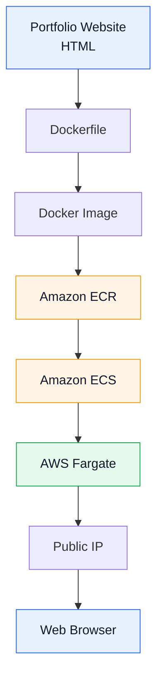
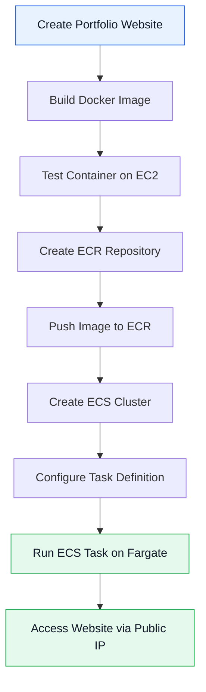

<h1 align="center">Serverless Container Deployment on AWS</h1>

<p align="center">
  <b>Deploying a containerized portfolio website using Docker, Amazon ECR, Amazon ECS, and AWS Fargate.</b>
</p>

<p align="center">
  
  
  
  
  
</p>

---

## 📌 Overview

This project demonstrates the end-to-end deployment of a containerized portfolio website on AWS using a serverless container architecture.

The website was containerized using Docker, tested on an Amazon EC2 instance, and stored in Amazon Elastic Container Registry (ECR). The container was then deployed through Amazon Elastic Container Service (ECS) using AWS Fargate.

With Fargate, AWS manages the underlying compute infrastructure, allowing the application to run without manually provisioning or managing EC2 instances for the production deployment.

## 🏗️ Architecture



## ✨ Key Features

- Containerized portfolio website using Docker.
- Custom Docker image stored in Amazon ECR.
- ECS task definition for container deployment.
- Serverless container execution using AWS Fargate.
- Public access to the deployed web application.
- IAM-based authentication and access management.
- Container networking and security group configuration.

## 🛠️ Technology Stack

| Category | Technologies |
|---|---|
| Cloud Platform | AWS |
| Containerization | Docker |
| Container Registry | Amazon ECR |
| Container Orchestration | Amazon ECS |
| Compute | AWS Fargate |
| Web Server | Apache HTTP Server |
| Operating System | Amazon Linux 2023 |
| Web Technologies | HTML |
| Cloud Tools | AWS CLI, IAM, VPC |

## 🔄 Deployment Workflow



## ⚙️ Implementation

### 1. Containerization

- Created a Dockerfile using Apache HTTP Server.
- Built a Docker image containing the portfolio website.
- Ran the container on an EC2 instance to verify application functionality.
---
### 2. Amazon ECR

- Created a private ECR repository.
- Authenticated Docker using AWS CLI.
- Tagged and pushed the Docker image to ECR.
---
### 3. Amazon ECS and Fargate

- Created an ECS cluster.
- Configured an ECS task definition with the ECR image.
- Selected AWS Fargate as the compute launch type.
- Configured networking and security groups.
- Launched the container and accessed the website through its public IP.
---
## 🔐 Security Configuration

| Component | Configuration |
|---|---|
| IAM | IAM user with ECR access |
| ECR | Private container image repository |
| SSH | Port 22 for EC2 administration |
| HTTP | Port 80 for web traffic |
| Testing | Port 8080 for container testing |

The EC2 instance was used for building and testing the image. The final application runs on Fargate without requiring a manually managed EC2 host.

## 📂 Project Structure

```text
serverless-container-deployment/
├── index.html
├── Dockerfile
├── README.md
└── Serverless Container Deployment on AWS.pdf
```

## 📄 Documentation

The complete implementation guide, including commands, configurations, screenshots, and deployment steps, is available here:

[📘 View the complete deployment guide](./Serverless%20Container%20Deployment%20AWS%20Docker%20ECR%20ECS%20Fargate.pdf)

## 🎯 Skills Demonstrated

<p align="center">
  
</p>

<p align="center">
  
  
  
</p>

<p align="center">
  
  
  
</p>

## ✅ Project Outcome

Successfully deployed a portfolio website as a Docker container on Amazon ECS using AWS Fargate.

The project demonstrates how containerized applications can be deployed on AWS without manually managing the underlying compute infrastructure.

## 📚 Key Learnings

- Building and managing Docker images.
- Publishing container images to Amazon ECR.
- Deploying containerized applications using Amazon ECS.
- Configuring Fargate tasks and networking.
- Understanding IAM permissions and container security.
- Implementing an end-to-end cloud deployment workflow.

---

<p align="center">
  <b>Built as a hands-on AWS and DevOps learning project.</b>
</p>

